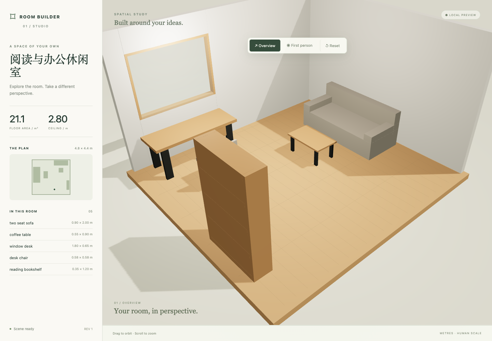
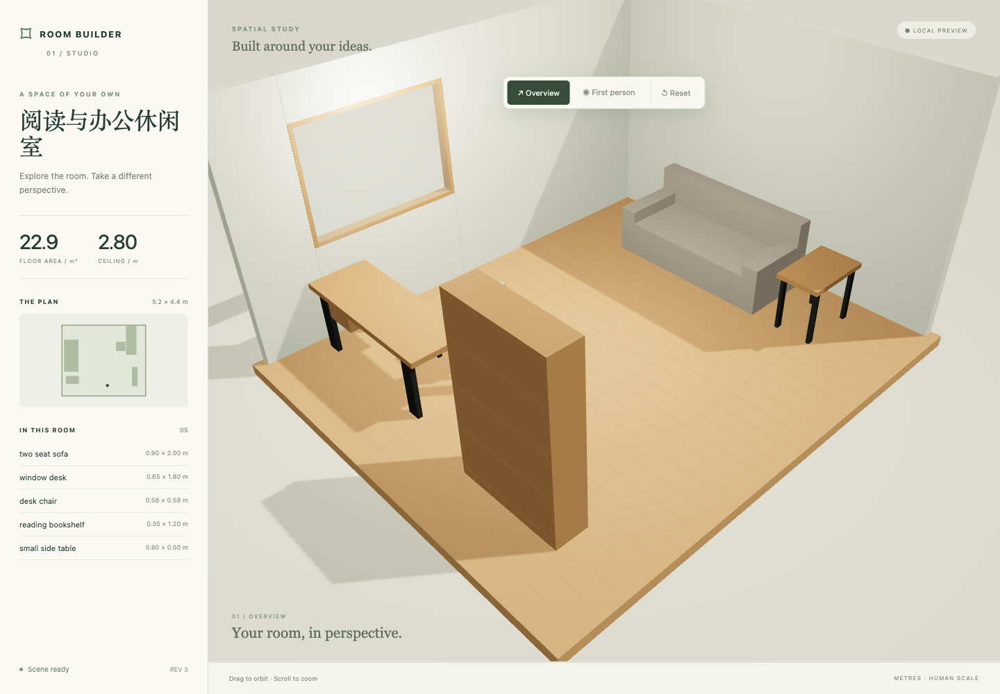
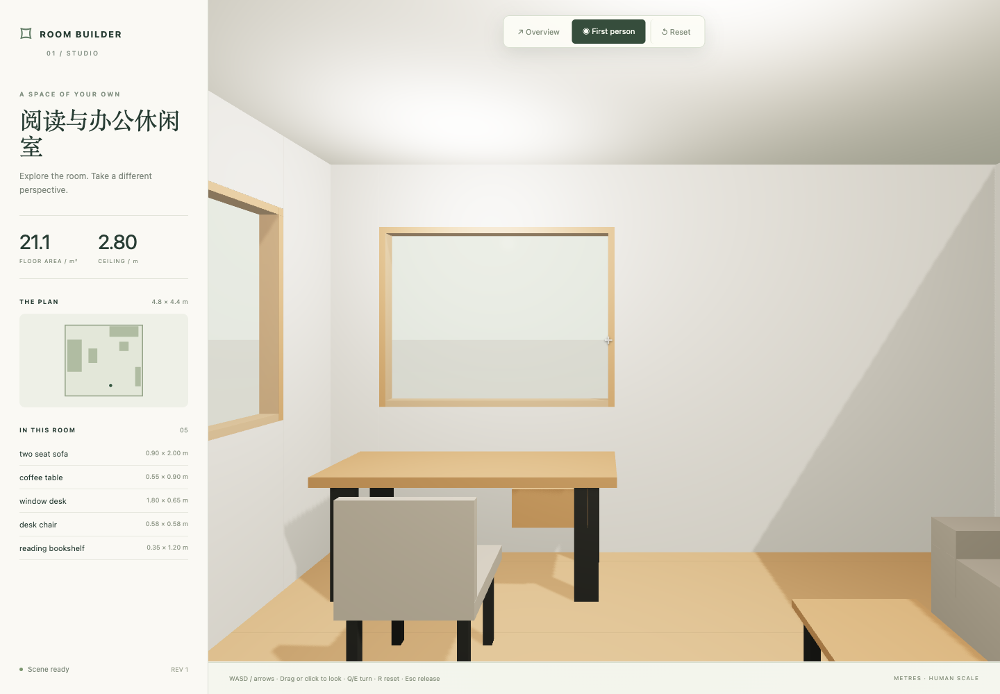

# Synthetic room demo

All rooms and images here are virtual examples generated by this project, not a real home.
Original examples and screenshots are covered by the root MIT license.

The fresh-user acceptance request created a 4.8 × 4.4m reading/office lounge with a sofa,
coffee table, desk, chair and bookshelf, a south door and north/east windows.
A first follow-up expanded its width to 5.2m and rotated the desk. A second removed the
coffee table, added a side table and changed the wall color and ambient light. Remaining
objects and properties were checked for equality after each edit.







Reproduce the final committed data without an AI host:

```sh
node scripts/room.mjs create --scene examples/lounge-demo.json --dir ./output/lounge
node scripts/room.mjs serve --dir ./output/lounge --port 5173
```

For natural-language creation and changes, use the prompts in README.md / README.zh-CN.md.
A request to place the bookshelf inside the sofa was rejected with an overlap error;
it did not change the current scene or active preview. Screenshots demonstrate actual
browser rendering, not photorealism, collision certification or mobile compatibility.

Reproduce both actual edits deterministically (revision 1 → 2 → 3):

```sh
node scripts/room.mjs create --scene examples/lounge-initial.json --dir ./output/lounge-sequence
node scripts/room.mjs apply --dir ./output/lounge-sequence --change examples/lounge-resize.change.json
node scripts/room.mjs apply --dir ./output/lounge-sequence --change examples/lounge-finish.change.json
```

The resulting scene equals lounge-demo.json, including stable IDs and revision.
Creation from lounge-demo.json alone starts a new workspace at revision 1.
